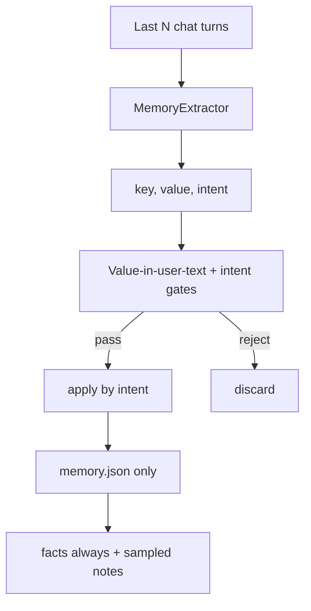

# Memory-System allgemein robuster machen

## Zielbild

Chat-Extraktion bleibt erwünscht. Kinito soll aus dem Gespräch **weiter Facts und Notes erzeugen** — aber nur wenn sie:

1. klar auf eine **User-Aussage** zurückgehen,
2. mit einem **Intent** (`add` / `replace` / `remove`) kommen, den die KI aus dem Satz ableitet,
3. bestehende Erinnerungen **nicht verfälschen**, wenn die Aussage unsicher ist.

Bugs (Regenbogen, Hangman, Oranges) sind **Regressionstests**, nicht der Scope.



---

## Devil's-Advocate-Korrekturen (in den Plan eingearbeitet)

| Kritik | Konsequenz fürs MVP |
|--------|---------------------|
| Komplexes `{value, evidence, confidence}` erhöht JSON-Fehler; `confidence` ist Self-Report des gleichen Modells | **Intent + value Pflicht**; evidence optional; confidence **kein Hard-Gate** |
| Evidence-Substring scheitert an Paraphrasen → False Negatives | Gate prüft, ob **Fact-Values** (Items) im User-Text vorkommen, nicht die Evidence-Paraphrase |
| Falsches `replace` zerstört Listen genauso wie heute | Bei Multi-Value-`replace`: Mehrheit der neuen Items muss im User-Text liegen, sonst reject |
| Word-Chain im Chat ohne `_is_game_active` | Zusätzliche leichte Chat-Spielheuristik + Game-Skip |
| Ein-Turn-Extraktion verpasst „Favorite food?“ → „Pizza“ | Extractor bekommt **letzte 2–4 Turns** als Kontext; Values müssen trotzdem in einer **User**-Zeile stehen |
| Phase 5 (Konsolidierung, Pin, volle Provenance) = Scope Creep | **Explizit „Later“**, nicht MVP |
| Auto-Migration löscht echte Favoriten | Migration **nur** Assistant-Spam-Notes; Facts nur manuell/Editor |
| Random-Prompt erschwert Debug | Sampling **tag-stabil** (Seed = Datum), nicht jeden Turn neu würfeln |
| `max_tokens=220` zu knapp für reicheres JSON | Extract-`max_tokens` anheben (ca. 400–500) |
| Legacy-Tests/alte LLM-Antworten | Altes Format (`"hobbies": "Crochet"`) weiter akzeptieren, Intent default `add` für Multi / `replace` für Single wenn leer sonst vorsichtig |

---

## MVP-Scope (umsetzen)

### 1) Extraktion mit Intent
Dateien: [`content/llm_prompts.py`](content/llm_prompts.py), [`kinito/memory/extractor.py`](kinito/memory/extractor.py), Aufruf in [`kinito/features/llm.py`](kinito/features/llm.py)

- Prompt: nur User-Behauptungen/Korrekturen; Themen/Spiele/Wortketten/Hypothesen nicht speichern; Assistant nie Fact-Quelle; keine Companion-Self-Talk-Notes.
- Schema bevorzugt:
```json
{
  "update_facts": {
    "favorite_snacks": {
      "value": ["Orangen", "Chips", "Eis"],
      "intent": "replace"
    }
  },
  "add_notes": [],
  "remove_notes": []
}
```
- Legacy weiter ok: `"favorite_snacks": "Orangen, Chips, Eis"` → als Multi-Value mit Intent-Default behandeln (siehe Gates).
- Kontext: letzte N User/Assistant-Turns (nicht nur der letzte Pair).
- Skip wenn `_is_game_active()`; plus Heuristik für reine Einwort-/Spielzüge im Chat.

### 2) Gates (Code, nicht Prompt-Hoffnung)
In `normalize_extraction` (User-Text = Konkatenation relevanter User-Zeilen aus dem Fenster):

- Jeder zu schreibende **Value-Token/Item** muss im User-Text vorkommen (casefold; leichte Normalisierung).
- `replace` Multi-Value: ≥50% der Items belegt, sonst reject (schützt vor Regenbogen-Listen).
- `add`/`remove`: betroffene Items belegt.
- Single-Value `replace`: Wert belegt + User-Turn nicht nur das nackte Wort ohne Präferenzkontext *oder* Wert steht in Antwort auf Memory-Frage im Fenster (Multi-Turn).
- Unsicher / Gate fail → Fact unverändert.

**Kein** englisches also/and-Keyword-Gate. Intent kommt vom Modell; Code prüft Beleg.

### 3) Apply nach Intent
[`kinito/memory/store.py`](kinito/memory/store.py):

| Intent | Multi-Value | Single-Value |
|--------|-------------|--------------|
| `replace` | Liste ersetzen | überschreiben |
| `add` | mergen/dedupe | setzen nur wenn leer, sonst ignore |
| `remove` | Item(s) entfernen | löschen bei Match |

Dialog-/Editor-`set_fact` bleibt unverändert stark.

### 4) `notes.txt` weg + Storage
- Spiegel entfernen (Save/Reset/README/Tests).
- Hard-FIFO-Löschen entfernen (oder Cap ≥500 ohne Delete — speichern unbegrenzt im Rahmen von JSON; Aufräumen = Editor).
- Note-Qualität: User-bezogen; Assistant-/Kinito-Zitate rejecten; Dedup behalten.

### 5) Prompt-Auswahl
In `as_prompt_block()`:

- Facts immer (kompakt); Daily-Facts bei Bedarf kürzen **nach** Sticky-Facts.
- Notes: ~recent + ~random aus dem Rest; **Seed = Kalendertag** (reproduzierbar pro Tag).
- Getrennte Budgets: Facts dürfen nicht von Notes verdrängt werden.
- **Runtime-Kontext (User):** Ollama `llama3.1:8b`, `num_ctx` derzeit **8k**. Daraus kalibrieren:
  - Memory-Block im Chat: `MAX_PROMPT_BLOCK_CHARS` ≈ **2200–2800** (heute 800 ist unnötig klein; 8k reichen dafür locker).
  - `MAX_NOTES_IN_PROMPT` ca. **30–40** bei getrennten Budgets (Facts zuerst).
  - Chat teilt 8k mit Systemprompt + History (`max_history` default 20) + Antwort — Memory darf History nicht sprengen.
  - **Ollama-Kontext hochstellen:** optional auf **16k**, wenn Chat mit längerem Verlauf + größerem Memory-Block abgeschnitten wirkt oder Extraktion mit Multi-Turn-Kontext knapper wird. Nicht nötig nur für den Memory-Block-Anstieg auf ~2.5k Zeichen. 32k+ nur bei genug VRAM und wenn wirklich langer Chat gewünscht ist (langsamer/mehr RAM).

### 6) Migration (leicht)
- Beim Load oder einmalig: Notes entfernen, die klar Assistant-Spam sind (Heuristik).
- **Keine** automatische Löschung von `favorite_*` / hobbies — User korrigiert im Editor.

### 7) Tests
- DE-Liste → replace; add; remove; Spielwort; Themen ohne Claim; Assistant-Note; Legacy-String-Schema; Multi-Turn „Pizza“; Prompt enthält ältere Note (Sampling); kein `notes.txt`.

---

## Explizit später (nicht MVP)

- Volle Provenance-Felder an jedem Fact (`source`/`updated` als Pflicht-Schema)
- Widerspruchs-Check über „Korrektur-Sprache“ (reintroduces Keyword-Risiko)
- Hintergrund-Konsolidierungs-Pass
- Pinning / Importance-Scores
- Persistentes Reject-Log UI
- Pending-Facts mit Verify-Frage vor Commit (alternativer Architekturpfad, falls MVP noch zu viele False Positives hat)

---

## Bewusst verworfene Alternativen

- **Facts nur noch aus Dialog-Fragen:** maximal sicher, widerspricht aber dem Ziel „Chat darf merken“.
- **Pending-Queue für jeden Chat-Fact:** robust, aber UX-schwer + mehr UI; Fallback falls MVP nicht reicht.
- **Zweites LLM-Validate-Pass:** teuer/langsam auf lokalem Ollama; erst bei Bedarf.

---

## Umsetzungsreihenfolge

1. Intent-Schema + Prompt + `max_tokens` + Multi-Turn-Kontext
2. Value-in-user-text Gates + Game/Chat-Spiel-Skip
3. `apply_extraction` nach Intent
4. `notes.txt` entfernen + FIFO weg
5. Prompt-Sampling (tag-stabil) + Budgets
6. Note-Qualität + leichte Note-Migration
7. Tests

---

## Offene Punkte (nicht blockierend)

- ~~Exactes Char-Budget / Ollama-Kontext~~ → kalibriert auf **llama3.1:8b @ 8k**; Memory-Block ~2.5k chars; 16k nur bei Bedarf.
- Wie aggressiv die „nacktes Einzelwort“-Heuristik sein darf, steuern die Tests (False-Negative vs. False-Positive).
